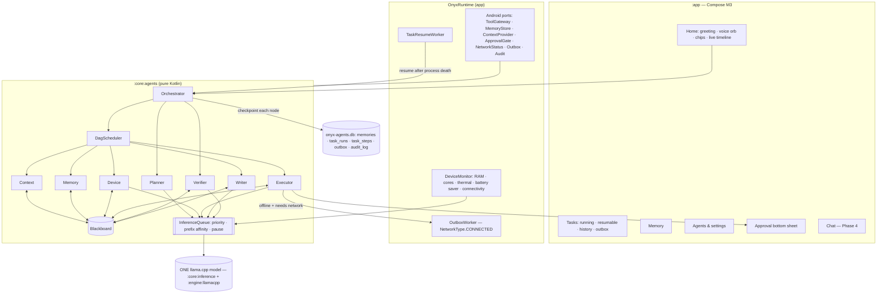

# Phase 5 — ONYX multi-agent runtime, device integration, offline-first outbox, new UI

Status: **built and unit-tested in the sandbox; not yet run on a phone** (target: OnePlus CPH2569, 8 GB). See §9.

## 1. What Phase 5 adds (summary)

| # | Requirement | Where | MVP level reached |
|---|---|---|---|
| 1 | Multi-agent orchestration on ONE shared model | `:core:agents` (pure Kotlin) | Orchestrator, Planner, Memory, Context, Device, Verifier, Executor (+ Writer). Typed `AgentMessage` sealed classes (kotlinx-serialization), `Blackboard`, DAG scheduler with parallel branches, single `InferenceQueue` (priority + prefix-cache affinity + thermal pause), retries with error feedback, re-delegation (Device → Memory), checkpoint after every node, resume. |
| 2 | Persistent, user-controlled memory + task state | `:core:data` `Phase5Database` (`onyx-agents.db`) | Memories (view/add/edit/pin/delete/export/clear, opt-out switch), task runs + per-step checkpoint rows, resume after process death via `TaskResumeWorker` (WorkManager). |
| 3 | Device integration | `app/onyx/*`, existing phone tools | Voice in (SpeechRecognizer; on-device recognizer when available, else `EXTRA_PREFER_OFFLINE` with a visible warning), TTS out, exact reminders (AlarmManager), brightness (WRITE_SETTINGS), notification post, save to Downloads (MediaStore), direct calendar insert (CalendarContract, WRITE_CALENDAR) — plus all Phase 3 tools (alarm/timer intents, DND, torch, volume, settings panels, app launch, SAF files, notification reading, accessibility). |
| 4 | Offline-first outbox | `OutboxProcessor` + `OutboxWorker` (NetworkType.CONNECTED) | Network-needing tool calls made offline are queued (already approved), run when a validated connection exists, with exponential backoff; Tasks → Outbox shows them; every tool has an Offline / Needs network badge. |
| 5 | Privacy & security | `ApprovalSheet`, `riskOf`, `audit_log` | Risk levels NONE…CRITICAL, bottom-sheet confirmation for every Executor action and every sensitive read, HIGH/CRITICAL never "always allowed", audit log of approvals/denials/actions/queued calls, everything on device. |
| 6 | Device-aware runtime | `RuntimeSelector`, `ThermalGovernor`, `DeviceMonitor` | Tier from RAM (ActivityManager.MemoryInfo) + cores + SoC, recommended context/threads/batch and models; PowerManager thermal listener pauses the inference queue at SEVERE+; battery-saver aware. |
| 7 | New UI | `ui/onyx/*`, `ui/theme/OnyxTheme.kt` | Dark-first Material 3 / Material You, bottom navigation (Home · Chat · Tasks · Memory · Agents), Home with greeting + animated voice orb + suggestion chips, live agent-activity timeline (working agents, DAG levels with "in parallel" brackets, per-step status, retries, re-delegation, verification ticks), approval bottom sheet, Tasks (running/resumable/history/outbox), Memory, Agents/settings with device tier + model picks + tool badges + audit log. Edge-to-edge. |
| 8 | Docs | this file, README.md | — |

## 2. Research summary

### 2.1 Android APIs used

| Capability | API | Permission / access | Notes |
|---|---|---|---|
| Voice input | `SpeechRecognizer.createOnDeviceSpeechRecognizer` (API 31+) when `isOnDeviceRecognitionAvailable`; else `createSpeechRecognizer` + `RecognizerIntent.EXTRA_PREFER_OFFLINE` | `RECORD_AUDIO` (runtime) + `<queries>` for `RecognitionService` | Only the on-device recognizer *guarantees* offline. With EXTRA_PREFER_OFFLINE the system recognizer may still use the network if no offline language pack is installed; ONYX shows "Speech: offline pack not guaranteed" in that case. |
| Voice output | `TextToSpeech` | none (`<queries>` TTS_SERVICE) | Uses the phone's TTS engine; most ship offline voices. |
| Device state | `ActivityManager.MemoryInfo`, `isLowRamDevice`, `Runtime.availableProcessors`, sysfs cpufreq (existing `DeviceInfo`), `Build.SOC_MODEL` (API 31+) | none | |
| Thermal | `PowerManager.addThermalStatusListener` / `currentThermalStatus` (API 29+) | none | Pauses new model work at SEVERE+. |
| Battery | `BatteryManager.BATTERY_PROPERTY_CAPACITY`, `isCharging`, `PowerManager.isPowerSaveMode` + `ACTION_POWER_SAVE_MODE_CHANGED` | none | |
| Connectivity | `ConnectivityManager.registerDefaultNetworkCallback`, `NET_CAPABILITY_VALIDATED` | `ACCESS_NETWORK_STATE` (normal) | Phase 5 re-allows this in the offline flavor (decision D21). |
| Background work | WorkManager `OneTimeWorkRequest` (`TaskResumeWorker`, `OutboxWorker` with `NetworkType.CONNECTED`) | none | |
| Exact reminders | `AlarmManager.setExactAndAllowWhileIdle` if `canScheduleExactAlarms()`, else `setAndAllowWhileIdle` | `SCHEDULE_EXACT_ALARM` (user grants on API 33+) | The tool reports whether the alarm is exact. |
| Calendar | `CalendarContract.Events` insert (direct) / `ACTION_INSERT` intent (existing) | `WRITE_CALENDAR` (runtime, opt-in) for direct | |
| Files | SAF tree grants (existing), MediaStore `Downloads` insert (API 29+) | none | |
| Notifications | `NotificationListenerService` (existing, opt-in), `NotificationManagerCompat.notify` | Notification access; `POST_NOTIFICATIONS` (API 33+) | |
| Settings | torch (`CameraManager.setTorchMode`), volume/ringer (`AudioManager`), DND (`NotificationManager` policy access), brightness (`Settings.System`, `WRITE_SETTINGS` special access), Settings panels (`Settings.Panel.*`) | as listed | |
| Screen / foreground app | existing `AccessibilityService` (opt-in, disclosed); `TYPE_WINDOW_STATE_CHANGED` gives the foreground package | Accessibility | No `PACKAGE_USAGE_STATS`. |

### 2.2 On-device runtime choice

| Option | Pros | Cons | Verdict |
|---|---|---|---|
| **llama.cpp (GGUF, JNI)** — current | Any GGUF model (Qwen3, Gemma 3, Llama 3.2…), GBNF grammar-constrained JSON (essential for small-model tool calls), KV prefix reuse, mature ARM NEON/i8mm kernels, already integrated + host-tested | CPU only on most phones (Vulkan/OpenCL immature on Adreno for this use), we maintain the JNI | **Keep.** Grammar sampling + prefix cache are what make multi-agent on one small model workable. |
| MediaPipe LLM Inference / LiteRT-LM | Google-maintained, GPU delegate, Gemma-optimised bundles | Limited model set, no general GBNF grammar, separate model format (re-download) | Possible future alternate engine behind `InferenceAdapter` for Gemma on GPU. |
| MLC LLM | GPU (OpenCL/Vulkan) compiled models, good speed | Per-model compilation, large toolchain, no grammar parity | Not now. |
| ONNX Runtime GenAI / ExecuTorch | NPU paths on some SoCs | Model conversion effort, uneven Android support | Not now. |

Model recommendations by tier (`RuntimeSelector`): Entry ≤4 GB → Qwen3 0.6B (Gemma 3 1B alternative) at 2K; Mid 6 GB → Qwen3 1.7B Q4_K_M at 4K; **High 8 GB (CPH2569) → Qwen3 1.7B Q4_K_M at 8K** (Llama 3.2 3B / Qwen3 4B as slower options); Flagship 12 GB+ → Qwen3 4B at 16K. Llama 3.2 3B (bartowski Q4_K_M) and Gemma 3 1B (ggml-org Q4_K_M) were added to the download catalogue (files checked on Hugging Face). Gemma 3n / "Gemma 4" are not in the catalogue: Gemma 3n E2B is ~3 GB at Q4 and untested with this llama.cpp build, and no Gemma 4 GGUF was verified.

### 2.3 Orchestration patterns considered

* **Single ReAct loop** (Phase 2–4 `AgentLoop`): simple, but one long prompt per step and no parallelism.
* **Plan-and-execute with a task DAG** (LLMCompiler-style): the planner emits steps with dependencies once; independent steps run in parallel; the model is needed only for planning, argument filling and the final answer. **Chosen.**
* **Blackboard architecture**: specialised agents share state through a board instead of chatting — far cheaper than agent-to-agent conversation on a 1.7B model. **Chosen** for shared state.
* **Supervisor / hierarchical** delegation with a **verifier** (self-check) and **re-delegation** on failure. **Chosen**, with deterministic rule checks first (cheap) and an optional grammar-constrained yes/no model check of the final answer.

Because there is one llama.cpp context, "parallel agents" means parallel *coroutines* (tool I/O, reads and memory search run concurrently) while model calls are **serialized** through `InferenceQueue`, ordered by priority and by prefix key (jobs with the same system prompt run back-to-back so the KV-cache prefix is reused).

## 3. Architecture

Plan shape: `Context ∥ Memory` (parallel roots) → tool steps (`Device` reads in parallel with each other; `Executor` actions after the reads they depend on) → `Writer` (always runs, even if a step failed, to explain what happened). Every node except the roots is checked by the `Verifier`.

Message types (`AgentMessage`, JSON-serialisable): `Delegate`, `Result`, `Failure`, `Verification`, `ApprovalAsked`, `QueuedOffline`. Node states: `PENDING → RUNNING → VERIFYING → DONE | FAILED | SKIPPED | QUEUED_OFFLINE | DENIED`.

Failure recovery: each node gets `maxAttempts` (2) with the error fed back (e.g. the model re-fills tool arguments); a Device read that still fails is re-delegated to Memory; actions are never re-delegated (no surprise side effects); a failed dependency skips its dependants; the Writer falls back to a template answer if the model fails, and its last attempt is kept but marked "unverified" so the user always gets an answer. Cancellation and crashes are checkpointed (`CANCELLED` / unfinished).

Resume: `TaskCheckpoint` (plan + node states + blackboard facts) is saved to Room after every node in one transaction (JSON for exact resume + one `task_steps` row per node). A unique `TaskResumeWorker` is armed (3 min) at every task start and at app start when unfinished runs exist; if the run is still alive it re-arms, otherwise it resumes: finished nodes are kept, unfinished ones run again (actions ask for approval again; an unanswered approval in a background resume times out as "declined" after 9 minutes).

## 4. Requirements

### Functional
1. The user can ask by voice or text; ONYX plans, gathers context/memory, uses tools, verifies and answers.
2. Any action that changes something (or reads sensitive data) needs explicit approval on a sheet showing risk, effect, arguments and network need.
3. Network-dependent actions taken offline are queued and run automatically when online; the user can see and cancel them.
4. Tasks survive process death and resume; the user can resume or discard them manually.
5. The user can view, edit, pin, delete, export and disable memory.
6. The user sees live which agent is working, the plan, parallel branches, retries and verification.
7. ONYX recommends model/context/threads for the phone and slows/pauses under heat or battery saver.

### Non-functional
* **Offline-first**: inference, memory, planning and device tools on-device; no telemetry; network only for the downloader (both flavors) and, in the connected flavor, remote MCP + `fetch_url`.
* **One model in RAM**: agents never load a second LLM; all model calls go through one queue.
* **Responsiveness**: no JNI/disk on the main thread (StrictMode in debug), state via StateFlow, bounded parallelism (3).
* **Safety**: Kotlin validates every tool argument against its schema before execution; HIGH/CRITICAL risks are never auto-allowed; audit log.
* **Testability**: orchestration logic is pure Kotlin with JVM tests (fakes for model, tools, context, memory).

## 5. Offline vs network capability table

| Capability | Offline | Needs network |
|---|---|---|
| Chat, planning, answers (local GGUF) | ✅ | |
| Memory, documents (RAG), notes | ✅ | |
| Device info, battery, thermal, time | ✅ | |
| Alarms/timers (Clock intents), exact reminders, notifications | ✅ | |
| Torch, volume, ringer, DND, brightness, settings panels | ✅ | |
| Calendar read/insert, contacts lookup | ✅ | |
| Files in granted folders (SAF), save to Downloads | ✅ | |
| Notification reading, screen reading/automation (opt-in) | ✅ | |
| Voice input | ✅ only with an on-device recognizer / offline language pack | otherwise the system recognizer may use the network |
| Text-to-speech | ✅ (offline voices) | some engines' online voices |
| Message/email/call **drafts** (user presses Send) | ✅ (the draft) | sending is done by the other app |
| Model download | | ✅ (huggingface.co only) |
| `fetch_url` (connected flavor) | queued in outbox | ✅ |
| Remote/LAN MCP tools (connected flavor) | queued in outbox | ✅ |

## 6. Known limitations (incl. what Android forbids)

* **Android forbids** normal apps from toggling Wi-Fi (API 29+ `WifiManager.setWifiEnabled` is a no-op), mobile data and airplane mode, and from reading other apps' private data or notifications without Notification access. ONYX opens the matching Settings panel instead.
* Brightness needs the user to grant "Modify system settings"; DND needs policy access; exact alarms need "Alarms & reminders" on Android 13+ (otherwise inexact, and the tool says so).
* The foreground app is known only while the accessibility service is enabled (no usage-stats permission).
* Voice input is guaranteed offline only with Android's on-device recognizer (API 31+ and a downloaded language pack).
* "Parallel" agents share one model: model-bound steps run one after another; only tool/IO work overlaps. A 3-step task needs ~3–5 model calls (plan, argument filling, answer, optional check).
* The planner is limited to 4 tool steps and ~10 relevant tools per request (prompt size on a phone). Small models can still plan poorly; the rule planner is the fallback.
* A background resume that needs approval waits up to 9 minutes (notification), then treats it as declined.
* Only explicit "remember …" requests become memories automatically; other facts are not auto-extracted (deliberately conservative).
* The Phase 5 database is separate (`onyx-agents.db`); the Phase 1–4 chat agent and its key/value memory still exist unchanged.
* "Continue in chat" re-asks the request in a new chat (it does not move the multi-agent context into the chat).
* Release (R8) build not produced; only debug APKs.

## 7. Decisions (continuing DECISIONS.md)

* **D21 – ACCESS_NETWORK_STATE in both flavors.** Needed for the online/offline indicator and WorkManager's CONNECTED constraint; it only reveals whether a connection exists. Wi-Fi state / change-network permissions stay stripped in the offline flavor.
* **D22 – Separate Phase 5 database.** The existing DB is version 1 without migrations; a second Room DB avoids any risk to chats and can be wiped independently.
* **D23 – Pure-Kotlin `:core:agents`.** Everything except the Android ports is JVM-testable.
* **D24 – Actions are never re-delegated or auto-retried after a denial**, and every Executor action with risk > NONE asks (unless the user chose "always allow" for a LOW/MEDIUM tool).

## 8. Tests (sandbox)

`./gradlew :core:agents:test` — 33 JVM tests: plan validation/levels/JSON round-trip, rule planner, DAG parallelism (deadlock-proof latch), bounded parallelism, skip-on-failure, tolerant writer, inference-queue serialization / priority / prefix affinity / pause / cancellation, orchestrator (rules-only, model plan with parallel reads + approved action, denial, offline → outbox, retry + re-delegation, verifier retry, writer fallback when the model fails, memory opt-out, cancellation checkpoint), resume (skip finished nodes, re-plan without a plan), outbox (offline, ordered drain, backoff, max attempts, non-retryable, interrupted item), verification rules, runtime selector + thermal governor. All module counts are in README.md.

## 9. Device test checklist (not yet done)

1. Install the offline APK → Home shows the Offline/Online pill correctly when toggling airplane mode.
2. Without a model: "How's my battery?" → rules plan → Device step → template answer.
3. With Qwen3 1.7B: "battery and turn on the torch" → timeline shows Context ∥ Memory, Device, Executor; approval sheet; torch turns on.
4. Deny an action → step shows "you declined" and the answer says so.
5. Connected flavor offline: "fetch https://example.com" → approval → queued in Tasks → Outbox; turn on Wi-Fi → runs, notification.
6. Start a task, then `adb shell am kill com.offlineagent.app` → within ~3 min (or at next launch) the task resumes (Tasks shows it).
7. Voice orb: check the on-device recognizer pill and that speech works in airplane mode.
8. Heat: run long tasks; at SEVERE thermal the queue shows "paused: cooling".
9. Memory: add/edit/pin/delete/export; turn memory off and check recall says "turned off".
10. Agents screen: tier = High (8 GB), recommended Qwen3 1.7B at 8K.
